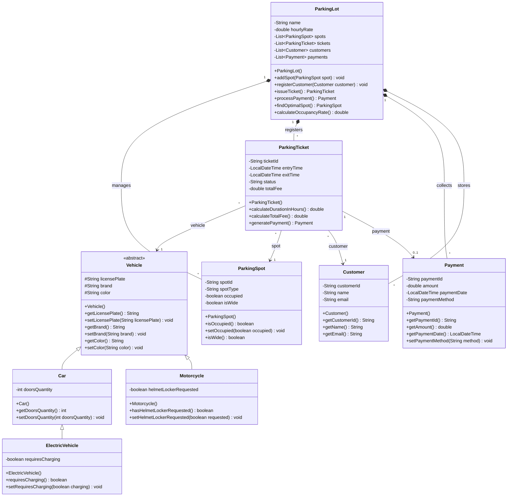

# Smart Parking System - Final Project POO

## Integrantes 
* **Daniel Sebastian Narvaez Muñoz** - Código: `75276` - Github: `@DanielSebastianN`
* **David Quinchia Morcillo** - Código: `75456` - Github: `@Quinchia2`

## Descripción general del sistema
Este sistema de gestión interna diseñado para que los operadores y administradores de un parqueadero automaticen y controlen las operaciones diarias del garaje. Desarrollado bajo los principios de la programación orientada a objetos en java, el sistema gestiona la asignación de espacios, la emisión de tiquetes al ingresar un vehículo, el cálculo dinámico de tarifas y la generación de recibos de pago a la salida.

## Instrucciones de ejecución 
### Prerrequisitos 
* **Java development kit (JDK 25 LTS)** o superior instalado.
* **Git** instalado para la gestión del repositorio.

---

### Pasos para ejecutar 

1. **Clonar el repositorio**:
   ```bash
   git clone https://github.com/Quinchia2/POO_FinalProject_Quinchia_Narvaez
   cd POO_FinalProject_Quinchia_Narvaez
   ```

2. **Compilar el código fuente**:
   ```bash
   javac -d bin src/**/*.java
   ```

3. **Ejecutar el sistema**:
   ```bash
   java -cp bin ui.Main
   ```
---

## Ejemplo de entrada / salida

```text
---Smart parking system - Main menu---
1. Register vehicle entry
2. Process vehicle exit & payment
3. View occupied parking spots
4. Generate csv daily report
5. Exit system
Select an option: 1

--Vehicle entry registration--
Enter license plate: ABC-123
Enter brand: Tesla
Enter color: Red
Select vehicle type (1. Car, 2. Motorcycle, 3. Electric vehicle): 3
Is charging required? (true/false): true

[Decision support] Optimal spot found: Spot E-02 (Electric charging station)
Ticket T-1001 Issued successfully
Entry time: 2026-11-22 14:00

---Smart parking system - Main menu---
1. Register vehicle entry
2. Process vehicle exit & payment
3. View occupied parking spots
4. Generate csv daily report
5. Exit system
Select an option: 2

--Vehicle exit & payment--
Enter ticket ID or license plate: ABC-123
Entry time: 2026-11-22 14:00
Exit time: 2026-11-22 16:30
Total duration: 2 hours 30 mins (Billed as 3 hours)
Vehicle Type: Electric vehicle (Base rate: $5.000/h x 1.2 multiplier)

Total fee calculated: $18.000
Select payment method (1. Cash, 2. Credit card, 3. Transfer): 2
Processing payment... Succes
Spot E-02 is now VACANT
Receipt PAY-5001 generated succesfully
```

---

## Diagrama de clases

